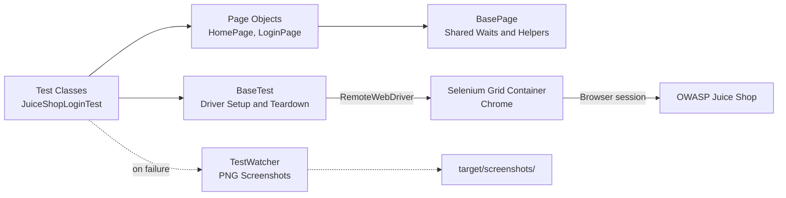
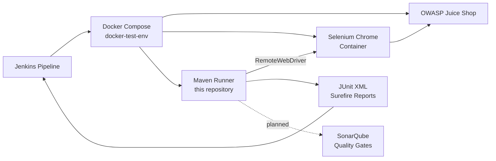

# 🏛️ Selenium 4 UI Automation Framework: Java, JUnit 5 & Page Object Model


### End-to-End Test Framework Built with Selenium WebDriver 4, JUnit 5 and Java

This repository is an automated **UI testing framework** structured around the **Page Object Model (POM)** pattern. It runs against the **[OWASP Juice Shop](https://github.com/juice-shop/juice-shop)** application using **RemoteWebDriver** against a **Selenium Grid (Chrome) container**, and publishes **JUnit XML results** to Jenkins.

It is the **Selenium layer** of a larger CI/CD ecosystem: [docker-test-env](https://github.com/acorvello/docker-test-env) orchestrates it with Juice Shop and a Selenium container inside a **Jenkins pipeline**, alongside the [Cypress](https://github.com/acorvello/e2e-cypress-js), [Playwright](https://github.com/acorvello/e2e-playwright-python) and [API](https://github.com/acorvello/api-testing) suites.

---

## 🗺️ Quick Navigation

* [Engineering Highlights](#-engineering-highlights)
* [Architecture](#-architecture)
* [Where It Fits: CI/CD Pipeline](#-where-it-fits-cicd-pipeline)
* [Tech Stack](#%EF%B8%8F-tech-stack--dependencies)
* [Project Structure](#-project-structure)
* [Covered Scenarios](#-covered-scenarios)
* [Running Locally](#-running-locally)
* [Running Through the Full Pipeline](#-running-through-the-full-pipeline-devops)
* [Roadmap](#-roadmap--next-steps)

---

## 💡 Engineering Highlights

* **Page Object Model (POM):** Test logic is separated from page locators, reducing maintenance overhead and selector debt.
* **Explicit & Fluent Synchronization:** `WebDriverWait` handles animations and element visibility, reducing flakiness without anti-patterns like `Thread.sleep`.
* **Failure Screenshots:** A custom JUnit 5 extension (`TestWatcher`) captures PNG screenshots of failed tests into `target/screenshots/` before the session ends.
* **Environment-Driven Configuration:** `BASE_URL` and `SELENIUM_URL` variables keep execution consistent locally, in Docker and in Jenkins.

---

## 🧭 Architecture



---

## 🧭 Where It Fits: CI/CD Pipeline



---

## 🛠️ Tech Stack & Dependencies

* **Language:** Java 17+
* **Automation API:** Selenium WebDriver 4.27 (`RemoteWebDriver` against a Selenium Grid container)
* **Execution & Assertions:** JUnit 5 (Jupiter)
* **Build & Reporting:** Maven (Surefire plugin producing JUnit XML)
* **Infrastructure:** Docker, Jenkins (via [docker-test-env](https://github.com/acorvello/docker-test-env))

---

## 📁 Project Structure

```text
e2e-selenium-java/
├── pom.xml
└── src/test/java/io/github/acorvello/selenium/
    ├── support/BaseTest.java
    ├── pages/
    │   ├── BasePage.java
    │   ├── HomePage.java
    │   └── LoginPage.java
    └── tests/JuiceShopLoginTest.java
```

---

## 🔍 Covered Scenarios

* **Home page:** loads successfully and lists the product components.
* **Navigation:** the login page renders when opened from the account menu.
* **Invalid login:** an error message is displayed when invalid credentials are submitted.

---

## 🚀 Running Locally

**Prerequisites:** JDK 17, Maven, Docker, and a running Juice Shop instance on port 3001.

Start the Selenium Chrome container:

```powershell
docker run -d --name selenium -p 4444:4444 --shm-size=2g selenium/standalone-chrome:4.27.0
```

**Windows (PowerShell):**

```powershell
$env:BASE_URL = "http://host.docker.internal:3001"
$env:SELENIUM_URL = "http://localhost:4444/wd/hub"
mvn test
```

**Linux / macOS:**

```bash
BASE_URL=http://host.docker.internal:3001 SELENIUM_URL=http://localhost:4444/wd/hub mvn test
```

JUnit XML reports are written by Surefire to `target/surefire-reports/`.

---

## 🐳 Running Through the Full Pipeline (DevOps)

This repository is consumed by the [docker-test-env](https://github.com/acorvello/docker-test-env) orchestration project. The pipeline starts Juice Shop alongside a Selenium Chrome container, runs this suite inside an isolated Maven container, and publishes the JUnit results to Jenkins.

---

## 🔗 Related Projects

* [docker-test-env](https://github.com/acorvello/docker-test-env): Docker Compose + Jenkins + SonarQube orchestration
* [e2e-cypress-js](https://github.com/acorvello/e2e-cypress-js): Cypress E2E suite
* [e2e-playwright-python](https://github.com/acorvello/e2e-playwright-python): Playwright E2E suite
* [api-testing](https://github.com/acorvello/api-testing): REST API tests with Pytest
* [Profile & ecosystem overview](https://github.com/acorvello)

---

## 📈 Roadmap & Next Steps

* Expand E2E coverage to multi-step cart and checkout flows
* Record video of failed test runs with the Selenium video container
* Add static analysis for this Java repository through SonarQube Quality Gates

---

## ⚖️ License

This repository is licensed under the **MIT License**. Feel free to clone, study, modify, and distribute the code for educational or portfolio purposes.

---

## 👤 Author

**Alexsander Corvello da Silveira**, Senior QA Engineer focused on AI-driven testing and applied machine learning.
GitHub: [@acorvello](https://github.com/acorvello)
